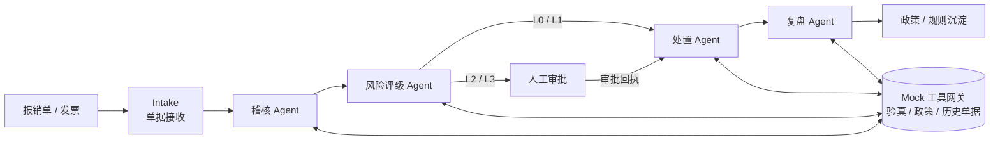

# 报销无忧 · Reimburse Zero

[](https://github.com/Alwayshere-su/reimburse-zero/actions/workflows/ci.yml)
[](LICENSE)
[](LICENSE-docs)
[](demo/tools/mock_tool_server.py)

> 面向企业费用报销的多 Agent 智能稽核与处置闭环。5 个业务 Agent + 1 个 TeamLeader，10 个 Skill，3 个可复现场景；打款等资金动作必须人工审批。

## 这是什么

「报销无忧」是 2026 GOAI【新智基座 | Agent Infra】赛道参赛作品。它把一张报销单的处理拆成五个职能 Agent：

**单据接收 → 政策稽核 → 风险评级 → 处置执行 → 复盘沉淀**

每个 Agent 只做职责内的事，通过 AgentTeams 共享上下文、传递中间结论；打款动作只生成审批计划，AI 不自动发起支付。仓库同时提供方案文档和一套可独立启动的 mock 工具网关。

> **状态**：初赛最小可运行 demo，不是生产系统。员工、发票、单据均为虚构脱敏数据，不包含任何真实企业数据。
>
> **运行边界**：`demo/tools/mock_tool_server.py` 可脱离 AgentTeams 独立启动和验证；完整多 Agent 链路需要按 [RUNBOOK](demo/at/AGENTTEAMS_RUNBOOK.md) 安装 AgentTeams、Docker 与 Element Web。本仓库未附带真实 AgentTeams 会话 trace。

## 5 分钟看懂

| 维度 | 内容 |
|---|---|
| 场景 | 企业费用报销 / 应付单据的稽核、风险分级、处置与复盘 |
| 角色 | Intake 单据接收、稽核、风险评级、处置、复盘，共 5 个业务 Agent + 1 个 TeamLeader |
| Skill | 10 个：`doc-extract`、`invoice-verify`、`policy-rag`、`duplicate-check`、`impact-assess`、`risk-assess`、`approval-guard`、`payment-verify`、`audit-report`、`data-query` |
| 场景数据 | `normal_claim` 自动放行 / `excess_claim` 退回补件 / `high_risk_claim` 升级人工 |
| 合规红线 | 打款必须携带人工审批回执；支付幂等；失败可回滚 |
| 工具层 | HTTP mock 工具网关，接口按 MCP 迁移成本设计 |
| 技术栈 | Python 标准库 + AgentTeams 配置驱动 |

## 架构



设计要点：

- **职责隔离**：Intake 不做合规判断，稽核不擅自放宽政策，风险评级不绕过人工审批，处置不无审批付款，复盘不直接改政策。
- **证据链**：每次工具调用写入 trace，审计报告可以回放“查了什么、命中哪条政策、为什么这样判”。
- **人工审批闸门**：`approval_required=true` 的场景，缺少审批回执的支付一律 `blocked`。
- **幂等与回滚**：同一 `payment_key` 不会重复扣款；支付失败可调用回滚工具。
- **配置驱动**：Agent、Skill、Team 编排主要落在 Markdown / JSON 配置中，便于迁移到 Nacos 或 Skill Registry。

## 快速开始：只跑 mock 工具网关

只需要 Python 3.10+，不依赖第三方包。

```bash
# 1. 启动工具网关
python demo/tools/mock_tool_server.py --host 127.0.0.1 --port 18089

# 2. 健康检查与场景列表
curl http://127.0.0.1:18089/health
curl http://127.0.0.1:18089/scenarios

# 3. 查一笔报销的发票验真结果
curl -X POST http://127.0.0.1:18089/tools/normal_claim/mock_invoice.verify \
  -H 'Content-Type: application/json' -d '{}'
```

Windows PowerShell 可以把 `curl` 换成 `Invoke-RestMethod`，或直接使用 Git Bash。

### 跑完整 AgentTeams 链路

1. 安装 AgentTeams（Docker + Element Web），参考 [demo/at/AGENTTEAMS_RUNBOOK.md](demo/at/AGENTTEAMS_RUNBOOK.md)。
2. 按安装器提示**在本机**配置模型与凭据；仓库内不保存任何 API Key、Token 或本地环境文件：
   ```bash
   bash <(curl -sSL https://higress.ai/hiclaw/install.sh)
   # 如需非交互包装：先下载官方安装器，再执行
   # AGENTTEAMS_INSTALLER=/path/to/install.sh bash scripts/run_agentteams_install.sh
   ```
3. 启动 mock 工具网关，并用 `docker inspect` 找到 manager 容器可达的宿主机网关地址。
4. 把 [create_agents_messages.md](demo/at/create_agents_messages.md) 中的 `<MOCK_TOOL_BASE_URL>` 替换为网关地址，发给 `manager` 创建 5 个 Worker 与 TeamLeader。
5. 进入 Team 房间，`@` TeamLeader 后依次发送 [run_demo_task_message.md](demo/at/run_demo_task_message.md) 中的三笔报销任务。

## 三个场景

| 场景 | 业务含义 | 预期处置 |
|---|---|---|
| `normal_claim` | 差旅 1,860 元，发票真实、符合标准、无重复 | L0 自动放行，入账 |
| `excess_claim` | 业务招待 6,800 元，超过单次上限 | 退回补件，要求事前审批说明 |
| `high_risk_claim` | 采购 15,800 元，与历史单据相似度 0.98 | 升级人工审批，支付阻断 |

场景数据在 `demo/scenarios/*.json`，全部为虚构样例。

## 仓库结构

```text
.
├── demo/                     # 最小可运行 demo（Agent / Skill / 场景 / mock 工具）
│   ├── agents/               # 5 个业务 Agent 的职责说明
│   ├── skills/               # 10 个 SKILL.md
│   ├── scenarios/            # 3 个报销场景
│   ├── tools/                # HTTP mock 网关与有状态 mock 工具
│   └── at/                   # AgentTeams 创建消息、team_spec、RUNBOOK
├── docs/
│   ├── 方案.md               # 完整参赛方案
│   ├── 改造指南.md           # 官方 OpsPilot Zero → 报销场景的映射
│   └── PPT优化诊断报告.md    # PPT 结构与信息密度复盘
├── scripts/
│   └── run_agentteams_install.sh
├── tests/
│   └── test_mock_tools.py
├── ATTRIBUTION.md            # 第三方素材与改造来源说明
├── LICENSE                   # Apache-2.0（代码与 Skill）
└── LICENSE-docs              # CC BY 4.0（文档）
```

## 文档

- [完整方案](docs/方案.md)：场景、架构、5 Agent 分工、8 步闭环、Skill 设计、安全审计、评估指标。
- [改造指南](docs/改造指南.md)：官方 Demo 与报销场景的逐目录映射，以及从零跑通的步骤。
- [AgentTeams 运行手册](demo/at/AGENTTEAMS_RUNBOOK.md)：环境安装、网关连通性、创建消息、任务发送、验收清单。
- [PPT 优化诊断](docs/PPT优化诊断报告.md)：18 页版本的信息密度问题与改版建议。

## 测试

```bash
python -m unittest discover -s tests -v
```

测试覆盖场景加载、发票验真、政策检索、支付审批闸门、审批回执后的支付、支付幂等和 trace 记录。

## 已知限制

- 所有外部系统都是 mock：税务验真、财务 ERP、支付网关、审批流均未接真实服务。
- 完整链路依赖 AgentTeams、Docker、Element Web 和可用的 LLM API；本仓库只保证 mock 网关可独立运行。
- LLM 输出具有采样随机性；演示重点是流程、边界和证据链，不是逐字复现。
- `demo/` 基于赛事官方 OpsPilot Zero Demo 骨架改造。官方原始压缩包未附带许可证文件，因此 **`demo/` 不属于 Apache-2.0 授权范围**，再分发或商用前需获得主办方或原作者授权；来源与授权边界见 [ATTRIBUTION.md](ATTRIBUTION.md)。
- 仓库不包含任何真实 API Key、Token、账号密码或本地环境文件；运行所需的模型凭据只在本机配置。

## 许可证

- 代码与 Skill：Apache-2.0，见 [LICENSE](LICENSE)。
- 文档：CC BY 4.0，见 [LICENSE-docs](LICENSE-docs)。
- `demo/`：派生自未附许可证的官方 OpsPilot Zero Demo 骨架，**不在上述许可证覆盖范围内**，需获得官方或原作者授权后方可再分发。
- 官方 OpsPilot Zero Demo 的原始版权归其作者所有；如官方发布许可证，以官方许可证为准。
- 答辩 PPT 不随仓库分发。
